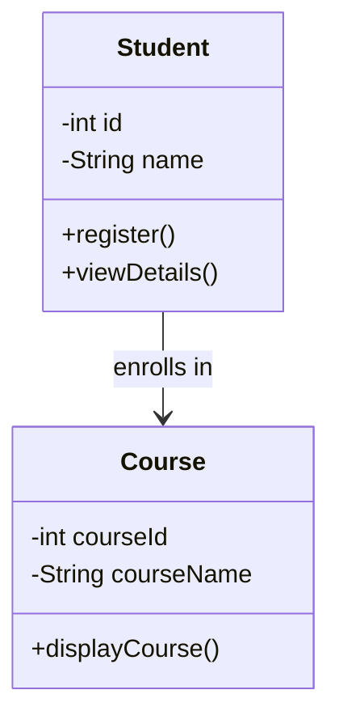

# UML Diagrams

## What is UML?

UML (Unified Modeling Language) is a standard visual language used to represent the structure and behavior of software systems.

## Types of UML Diagrams

### 1. Class Diagram
Represents classes, attributes, methods, and relationships.

### 2. Use Case Diagram
Shows interactions between users (actors) and a system.

### 3. Sequence Diagram
Shows how objects communicate with each other over time.

### 4. Activity Diagram
Represents the workflow or sequence of activities in a system.

## Example: Class Diagram

## Why UML is Important

- Helps visualize software architecture.
- Improves communication between developers.
- Makes complex systems easier to understand.
- Helps identify relationships between classes.
- Supports software planning and documentation.
